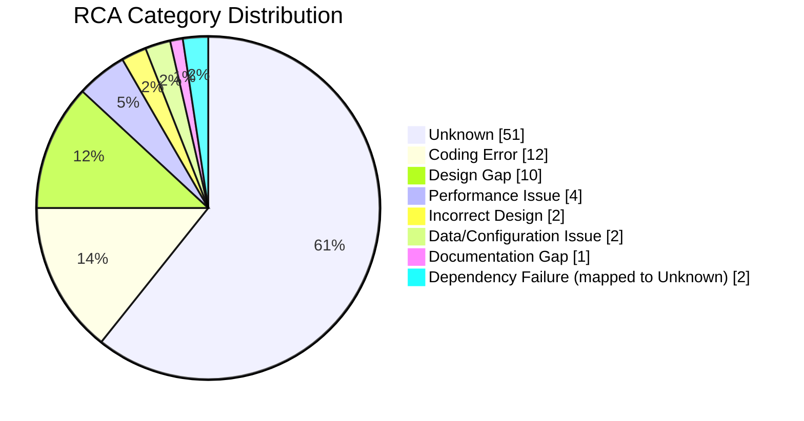

# AAVA Bug RCA Analysis Report — Active
    

> [!IMPORTANT]
> ## Summary
> This report covers 84 Active Bug work items from AAVA in Azure DevOps. Unknown is the dominant RCA outcome at 60.71%, followed by Coding Error at 14.29% and Design Gap at 11.90%, showing that many defect records still lack enough mechanism-level detail for precise attribution. Total derived remediation effort is 80.38 days, with the largest concentration in Unknown items because many fixes require reproduction, investigation, or cross-layer validation before implementation can be scoped confidently. 12 defects lacked enough data for root-cause naming and were marked Insufficient data, with missing repro steps as the primary data-quality gap. The clearest remediation signal is to enforce richer defect capture—especially reproducible steps and failing component context—before triage and sizing.

---

## RCA Category Distribution

| RCA Category | Count | Percentage |
|---|---:|---:|
| Unknown | 51 | 60.71% |
| Coding Error | 12 | 14.29% |
| Design Gap | 10 | 11.90% |
| Performance Issue | 4 | 4.76% |
| Incorrect Design | 2 | 2.38% |
| Data/Configuration Issue | 2 | 2.38% |
| Documentation Gap | 1 | 1.19% |
| Dependency Failure (stored outside allowed taxonomy, mapped to Unknown) | 2 | 2.38% |
| **Total** | **84** | **100.00%** |

---

## State Distribution

| State | Count | Percentage |
|---|---:|---:|
| 🔄 Active | 84 | 100.00% |

---

## Effort Profile

| Tier | Rule Used | Defects | Effort |
|---|---|---:|---:|
| 🟢 Small | up to 6h | 21 | 4.38 days |
| 🟡 Moderate | >6h to 12h | 24 | 24.50 days |
| 🟠 Large | >12h to 3 days | 28 | 46.50 days |
| 🔴 Largest | >3 days | 11 | 5.00 days |
| ⚪ Unestimated | Insufficient data | 12 | 0.00 days |

> [!NOTE]
> Effort is derived per defect from the scope of the recommended fix, not from ADO estimate fields. 1 day = 8 hours; work under 12 hours is shown in hours, and 12 hours or more is shown in 0.5-day steps.

> [!WARNING]
> Effort concentrates most heavily in Unknown-classified defects because multiple records need reproduction, component isolation, or cross-layer investigation before implementation can be narrowed. This is a process smell: poor defect specificity is directly inflating delivery uncertainty.

- **Total estimated effort:** 80.38 days
- **Spread:** Unestimated to 4 days
- **Unestimated count:** 12
- **Largest effort share:** Unknown, then Coding Error, then Design Gap

---

## Detailed Defect Table

<b>Full defect table (84 defects)</b>

| Defect ID | Title | State | RCA Category | Root Cause | Recommended Fix | Time to Fix |
|---:|---|---|---|---|---|---|
| 120042 | Analytics UI: Align Users, Overview & Quality/Performance Experience with Updated Terminology, Content and Usability | 🔄 Active | 📐 Design Gap | Cross-view analytics screens lack a single UX contract for labels, warnings, navigation cues, and table behaviors. | Update analytics UI specs and implement the approved terminology/navigation pattern across tabs; verify with UX regression on all listed views. | 🔴 4 days (cross-layer + contract change) |
| 67054 | Execution logs transparency with logs and output history | 🔄 Active | ❓ Unknown | Insufficient data — no repro steps. | Reproduce and document steps before scoping a fix. | ⚪ Unestimated |
| 66823 | GitHub and Jira Integrations Require Manual Hand-Offs in AAVA | 🔄 Active | ❓ Unknown | Insufficient data — missing repro steps and failing integration behavior details. | Reproduce and document steps before scoping a fix. | ⚪ Unestimated |
| 67310 | Login page crashes on submit | 🔄 Active | ❓ Unknown | Insufficient data — no repro steps and no failing component detail. | Reproduce and document steps before scoping a fix. | ⚪ Unestimated |
| 75767 | OBO error handling scenarios | 🔄 Active | ❓ Unknown | Insufficient data — no repro steps. | Reproduce and document steps before scoping a fix. | ⚪ Unestimated |
| 109549 | Tech Debt - AIPO: Need DB script from Dev team to create schema [collection] for newly provisioned Document DB in AWS UAT | 🔄 Active | ❓ Unknown | Insufficient data — no repro steps and no failing mechanism captured. | Reproduce and document steps before scoping a fix. | ⚪ Unestimated |
| 115928 | Tech Debt - Move a PE Property from AAVA Secret to Key Vault | 🔄 Active | ❓ Unknown | Insufficient data — this is a change request without defect mechanism or failure steps. | Reproduce and document steps before scoping a fix. | ⚪ Unestimated |
| 116627 | Script available as part of Repo but not in DR for UAT & INT has to be removed | 🔄 Active | ❓ Unknown | Insufficient data — no repro steps and no failure behavior described. | Reproduce and document steps before scoping a fix. | ⚪ Unestimated |
| 61736 | GGM UK-PS->Brainstorming->Roadmap is failing(500 Internal server) | 🔄 Active | ❓ Unknown | Insufficient data — no repro steps. | Reproduce and document steps before scoping a fix. | ⚪ Unestimated |
| 61898 | GGM UK ->PS ->Goal and Metrics Planner->Previously revised data change back to default with a new revise request | 🔄 Active | ❓ Unknown | Insufficient data — no repro steps. | Reproduce and document steps before scoping a fix. | ⚪ Unestimated |
| 69691 | Left nav is not consistent | 🔄 Active | ❓ Unknown | Insufficient data — missing repro steps and inconsistent behavior is not localized to a component. | Reproduce and document steps before scoping a fix. | ⚪ Unestimated |
| 101438 | Hierarchy  Icon has no hover/ either experience should be same across platform iconwith hover / action button | 🔄 Active | ❓ Unknown | Insufficient data — repro steps do not identify the failing interaction beyond a broad module reference. | Reproduce and document steps before scoping a fix. | ⚪ Unestimated |
| 112562 | UAT - Knowledge Base - Creation Fails with Gemini Embedding Model | 🔧 Coding Error | Gemini credential initialization uses an issuer configuration that does not match the token issuer used for Vertex impersonation. | Correct Gemini credential issuer configuration in embedding service auth flow and verify KB creation with Gemini in UAT. | 🟠 3 days (config + integration verification) |
| 112565 | Agent execution fails when using Gemini models | ❓ Unknown | Gemini execution path rejects ID tokens because configured issuer validation does not match the runtime token issuer. | Align Gemini auth configuration for execution service and verify agent runs successfully across supported Gemini models. | 🟠 3 days (cross-service auth validation) |
| 120858 | Azure-QE ADO Team Mapping – Team Sync Fails with 500 Internal Server Error During Team Fetching | 🔧 Coding Error | The team-fetching workflow passes a list into TaskOutput.raw where downstream validation requires a string payload. | Serialize or remap the team-fetch output in the ADO sync workflow and verify sync completes without schema validation errors. | 🟡 10h (new integration test) |
| 119713 | Agent output from a completed process becomes unavailable if the agent is edited after the process is executed | 🔧 Coding Error | Process execution history resolves live agent metadata instead of preserving the versioned output snapshot from execution time. | Persist and read process output from execution snapshots rather than current agent state; verify historical runs after agent edits. | 🟠 2.5 days (state handling + regression) |
| 113137 | Agent output from a completed process becomes unavailable if the agent is edited after the process is executed | 🔧 Coding Error | Process execution history resolves live agent metadata instead of preserving the versioned output snapshot from execution time. | Persist and read process output from execution snapshots rather than current agent state; verify historical runs after agent edits. | 🟠 2.5 days (state handling + regression) |
| 119883 | [INT] Editing and saving combined output from two agents inside Inplace editor does not work | 🔧 Coding Error | The inplace editor binds save state to a single upstream node instead of the merged consolidated output payload. | Fix HITL editor state binding for merged outputs and verify edited consolidated output persists after save. | 🟡 10h (state handling + integration test) |
| 114967 | Node status is shown as Completed instead of Failed when an instance completes successfully but returns a result that matches the custom failure conditions. | 🔧 Coding Error | Process Playground status mapping ignores custom failure-condition evaluation when the execution transport finishes successfully. | Apply custom failure-condition result to node status rendering in Process Playground and verify failed-state parity with Mini Playground. | 🟡 8h (logic correction + regression) |
| 115280 | HITL/Agent Connected After a Merge Node Containing PE Nodes Does Not Receive the Merged Output | 🔧 Coding Error | The merge node does not propagate its aggregated payload to downstream HITL consumers in the PE execution path. | Fix merge-node output propagation for downstream HITL/Agent nodes and verify merged payload is visible after execution. | 🟡 8h (logic correction + integration test) |
| 108441 | [QE, INT] User Is Redirected to Process Canvas Design Page After Saving Workflow or Agent | 🔧 Coding Error | Save completion triggers the wrong post-save navigation target and sends users back to hierarchy selection instead of the artifact context. | Correct save-success navigation routing in workflow/agent canvas and verify both create flows remain on the expected page. | 🟡 6h (single-module UI logic) |
| 117758 | 3 Month and 1 year filter for trend charts omit last bucket data | 🔧 Coding Error | Trend bucketing assigns executions with fixed 30-day arithmetic while chart buckets are rendered by calendar month boundaries. | Replace fixed-day bucket assignment with calendar-aware month/week bucketing in analytics API and verify latest bucket coverage. | 🟡 10h (logic + regression) |
| 119998 | New Users – Data Not Displayed for the Last 1 Month Filter | ❓ Unknown | The 1-month analytics filter uses date-range or metric semantics that exclude current-period user data while the 1-year view includes it. | Align month-filter query semantics with displayed metric definition and verify current-period data appears in 1-month and 1-year views. | 🟡 8h (logic + regression) |
| 119923 | INT - Context Relevancy displays an invalid RAG score of -1.00 in Workflow Playground Metrics : WF name - WF with KB and Tool | 🗄️ Data/Configuration Issue | Sentinel score -1 from the evaluation pipeline is exposed to the UI instead of being mapped to an unavailable metric state. | Map sentinel metric values to a non-score placeholder in API/UI and verify valid zero scores remain unchanged. | 🟡 6h (single-flow mapping + regression) |
| 120096 | INT - Trulens dashboard crashes due to version mismatch between trulens dashboard and core | ❓ Unknown | Dependency versions drifted after lockfile removal, leaving the dashboard and core packages on incompatible Trulens versions. | Restore deterministic dependency pinning for Trulens components and verify dashboard access in INT and UAT. | 🟡 8h (dependency alignment + verification) |
| 101031 | AWS: ES Generate UI Design is getting stuck at 92 % and sometimes showing Error when moved to back screen | ❓ Unknown | UI design generation does not complete reliably and navigation during background processing leaves the frontend in a stale progress state. | Trace the generation completion and screen-state handoff, fix the stalled progress handling, and verify repeated generation runs on AWS. | 🟠 2 days (intermittent + integration verification) |
| 118373 | Azure QE ES: Intermittent 401 Unauthorized Error Occurs While Generating UI Design | ❓ Unknown | UI design generation intermittently loses or rejects authorization during backend request execution. | Trace auth token propagation in UI design generation, fix the authorization lapse, and verify stability across repeated runs. | 🟠 2 days (intermittent auth path) |
| 101072 | Azure QE ES: ES Previously Uploaded Image Appears in AI Chat for UI Design Created with and without attached image | ❓ Unknown | AI chat view reuses the most recent uploaded image state instead of the image bound to the opened design session. | Isolate image state per UI design/session and verify reopened designs show only their own attachment context. | 🟡 8h (state isolation + regression) |
| 120877 | Azure-QE Team Configuration – Saved Jira or ADO Projects/Boards Are Not Retained Across Product Tabs | ❓ Unknown | Product-tab switching reloads team configuration without restoring the saved project/board mapping for the selected integration. | Fix retrieval/persistence of team mappings across product tabs and verify saved Jira/ADO boards reappear after tab changes. | 🟡 8h (state retrieval + regression) |
| 111461 | IMS - Cognos to PBI - BIM Conversion Status Remains "In Progress" on Convert Screen While Monitoring Logs Show "Completed" | 📐 Design Gap | The Convert screen lacks a reliable status refresh contract to reconcile backend completion with frontend conversion state. | Rework status refresh between conversion job status and Convert UI state; verify completed jobs auto-update without manual refresh. | 🟡 10h (state/lifecycle handling) |
| 111488 | IMS - WebFocus to Power BI - Test Use Cases Option Remains Disabled Due to PBIT Generation Failure | ❓ Unknown | The UI enablement for Test Use Cases depends on a PBIT artifact that is not being generated successfully. | Trace PBIT generation failure path, restore artifact creation, and verify Test Use Cases enables after successful generation. | 🟠 2 days (backend dependency + verification) |
| 115623 | IMS – Cognos to PowerBI – Validated report file is not downloading when clicking the Download icon. | ❓ Unknown | Download action indicates success but the generated validation artifact is not retrievable from its backing storage or response path. | Trace validation-report storage and download response handling, fix missing file retrieval, and verify actual file download completes. | 🟡 8h (storage path + manual verification) |
| 111293 | Agent output takes more than expected time to load when using Gemini 2.5 Flash and Gemini 2.5 pro with Knowledge Base | ⚡ Performance Issue | Knowledge-base agent execution with Gemini models has a slow inference or retrieval path that delays output rendering beyond expected response time. | Profile KB retrieval and Gemini execution path, optimize the slow stage, and verify end-to-end response time on repeated executions. | 🟠 2 days (performance profiling + integration test) |
| 29939 | The current build is experiencing performance issues. | ⚡ Performance Issue | Multiple runtime paths are slow under current build conditions, indicating broad latency across KB save, logs, playground, and approval screens. | Break down the reported hotspots by endpoint and optimize the slowest services first; verify representative flows against baseline timings. | 🔴 4 days (multi-module performance investigation) |
| 37288 | Light House Testing: Poor Performance score Due to Heavy JavaScript, Large Payloads, and Blocking Requests for QE Console MySpace - (https://aava-qe.avateam.io/console/mySpace) | ⚡ Performance Issue | MySpace load is dominated by oversized bundles, blocking API chains, and render-blocking assets that delay main content paint. | Reduce JS payload, defer noncritical assets, and optimize the blocking API chain; verify Lighthouse and real-page timings improve. | 🔴 4 days (cross-layer performance) |
| 37532 | Light House Testing: performance delays during initial load, accessibility gaps, and best-practice warnings for QE Console Guardrails - (https://aava-qe.avateam.io/console/build/guardrails/create) | ⚡ Performance Issue | Guardrails page loads too much configuration and JavaScript upfront, blocking initial render and interaction. | Split route payloads and defer noncritical configuration on Guardrails create page; verify improved FCP/LCP and accessibility regressions. | 🟠 3 days (route redesign + verification) |
| 40036 | When you open a tool, the “tools inputs” section takes so long to load | ⚡ Performance Issue | Tool input pane initialization performs slow data loading or rendering before the input section becomes usable. | Profile tool-input initialization path, remove the slow dependency, and verify faster panel readiness on tool open. | 🟡 8h (targeted performance fix) |
| 65577 | Filter Panel in Discovery Page inconsistent design | 🎨 Incorrect Design | The Discover filter panel was implemented with a layout and field styling that diverges from the approved design system. | Rebuild the filter panel to match approved design tokens/components and verify visual parity against Figma. | 🟡 10h (UI redesign + QA review) |
| 70021 | Creation of agent screen allows the full screen scroll when the user want the scroll for only description area | 🎨 Incorrect Design | Scroll containment is applied at page level instead of within the agent description editor region. | Restrict scrolling to the description container and verify page-level scroll stays stable during long text editing. | 🟢 4h (single-component layout fix) |
| 70019 | Experience of Left nav auto loading is different in platform and studio | 📐 Design Gap | Platform and Studio implement different left-nav auto-load behavior because navigation behavior was not standardized across surfaces. | Define a shared left-nav loading pattern and apply it consistently in platform and studio; verify interaction parity. | 🟡 8h (shared UX behavior) |
| 65587 | Button behaviour needs to be according to Play component | 📐 Design Gap | Interactive elements do not consistently follow Play design-system behavior, states, or visual affordances. | Replace noncompliant buttons with Play DS variants and verify state behavior across representative screens. | 🟠 2 days (multi-screen component cleanup) |
| 67056 | Guided approach for agent creation screen | ❓ Unknown | Insufficient data — no repro steps and this reads as a feature gap rather than a specific defect mechanism. | Reproduce and document steps before scoping a fix. | ⚪ Unestimated |
| 68309 | Guardrail should not completely block a small message or update before the expecution experience comeplted for 20 mins and gets block | ❓ Unknown | The guardrail flow over-blocks intermediate user updates and leaves execution hanging until a late block condition is reached. | Reproduce the long-running guardrail flow, isolate the blocking decision point, and verify smaller updates are handled correctly. | 🟠 2 days (policy-flow investigation) |
| 69767 | Users create tools but cannot tell whether the generated code is correct. Even after refining prompts, confidence in the match between intent and output remains low. Participants want active guidance, not just execution. | ❓ Unknown | The tool-creation experience lacks mechanisms that explain, validate, or guide generated code against the user’s stated intent. | Add intent-to-output validation cues and guidance in tool creation, then verify user can inspect and trust generated code paths. | 🔴 3 days (interaction redesign) |
| 61881 | [UI]: UI Freezing when excuting the workflow logs | ❓ Unknown | The workflow logs view blocks the UI thread or waits synchronously while rendering execution log data. | Profile workflow log rendering/fetch path, remove the blocking operation, and verify the logs view stays responsive. | 🟠 2 days (render-path investigation) |
| 62532 | Newly Added Level Is Not Displayed at the Top of the Levels List | 🔧 Coding Error | The hierarchy list query does not sort newly created levels in descending creation or ID order. | Apply deterministic descending sort in level-list retrieval and verify new levels appear at the top after save. | 🟢 3h (single-query fix) |
| 62506 | QE - Approve Tab - Incorrect Toast Message Displayed When Sending Back Agents | 🔧 Coding Error | Send Back action reuses approval toast messaging instead of action-specific response text. | Correct toast message mapping for Send Back action and verify self-action restrictions show the proper message. | 🟢 2h (single-line mapping fix) |
| 69435 | Sudo - Incorrect Confirmation Popup Message Displayed When Saving a New User and Adding a New Level | 📄 Documentation Gap | Confirmation dialog text is hardcoded to an admin-specific message and not parameterized by action context. | Parameterize confirmation-dialog copy by operation type and verify Add User and Add Level show correct text. | 🟢 4h (copy mapping + UI check) |
| 60599 | DEV2/RBAC-Console - Sort By Filter Is Not Functioning Correctly in Approval Section | ❓ Unknown | Sort selection in Approval does not propagate correctly to the data ordering logic used by the approval list. | Trace filter-to-query sort propagation in Approval and verify records reorder for each supported sort option. | 🟡 6h (single-flow logic) |
| 66901 | QE - Access Management - Duplicate Role Assignment for Admin Users Succeeds Without Validation | ❓ Unknown | Role assignment path does not block or detect duplicate role membership before persisting admin updates. | Add duplicate-role validation before admin role save and verify duplicate assignment is rejected with a clear message. | 🟡 6h (validation + regression) |
| 90319 | Agent Creation - "Summarization" Good At Tag Is Not Generated for "Summary Agent" Prompt | ❓ Unknown | Tag generation relies on exact keyword matching and misses synonym intent such as summary versus summarization. | Add synonym-aware tag mapping in agent creation and verify equivalent prompts generate the same Good At tags. | 🟡 8h (logic enhancement + tests) |
| 101657 | Agent Matching - Existing Agents Are Not Matched When Prompt Uses a Short/Generic Description Instead of Exact Agent Details | ❓ Unknown | Agent matching is tuned to exact description overlap and fails to surface relevant agents from short intent-based prompts. | Improve matching to use intent/semantic terms instead of exact descriptions only and verify generic prompts return relevant agents. | 🟠 2 days (ranking/model adjustment) |
| 97159 | MCP Table and Graph Data Are Not Displayed After Workflow Execution with MCP | ❓ Unknown | Analytics ingestion or query logic does not record successful workflow-triggered MCP executions for the MCP views. | Trace MCP analytics ingestion from workflow execution to dashboard query and verify records appear in table and graph. | 🟠 2 days (pipeline + verification) |
| 68842 | Total MCP Execution Count Does Not Include Workflow Executions | ❓ Unknown | MCP total-count aggregation includes agent-triggered executions but omits workflow-triggered records from its query logic. | Update MCP execution aggregation to include workflow-triggered runs and verify totals match underlying executions. | 🟡 8h (query correction + regression) |
| 82905 | Recommended Filter Is Not Working for Knowledge Base Artifacts in Context Aware Screen | ❓ Unknown | Recommended-filter logic is implemented for tools but not correctly applied to knowledge-base artifact queries. | Align KB recommendation filter logic with tool filtering behavior and verify recommended KBs appear in Context Aware. | 🟡 8h (query/filter parity) |
| 101657 | Agent Matching - Existing Agents Are Not Matched When Prompt Uses a Short/Generic Description Instead of Exact Agent Details | 🔄 Active | ❓ Unknown | Agent matching is tuned to exact description overlap and fails to surface relevant agents from short intent-based prompts. | Improve matching to use intent/semantic terms instead of exact descriptions only and verify generic prompts return relevant agents. | 🟠 2 days (ranking/model adjustment) |
| 90340 | QE - Manage Users - Newly Created Users Are Not Displayed in the User List | ❓ Unknown | User creation succeeds but the Manage Users listing does not refresh or query the newly created record set correctly. | Fix post-create list refresh/query criteria in Manage Users and verify newly created users are visible and searchable. | 🟡 6h (single-flow refresh logic) |
| 111253 | Execution Logs Display Source, Chunk, and File as Null for KB-Based Agent Execution | ❓ Unknown | KB retrieval metadata is dropped or unmapped before execution-log rendering, leaving source fields null in the UI. | Trace KB metadata from retrieval output to execution-log view, restore field mapping, and verify source/file/chunk values display. | 🟡 10h (cross-layer mapping) |
| 111437 | Sudo - Unauthorized Launchpad Access via URL Change and Console Loading Followed by Logout | ❓ Unknown | Route authorization is checked too late, allowing unauthorized app shells to load before access is denied or session is dropped. | Enforce role authorization before route bootstrap for Launchpad/Console and verify direct URL access is denied without logout. | 🟡 10h (auth guard + regression) |
| 111940 | Agent name editing freezes when attempting to edit a Draft agent | ❓ Unknown | Draft-agent name editing enters a stuck UI state, likely due to edit-mode state not reconciling after prior draft actions. | Fix draft-agent name edit state lifecycle and verify repeated edit/save interactions remain responsive. | 🟡 6h (single-module state handling) |
| 116704 | Disabled Action Options Remain Clickable in Artifact Menu on Discover Tab | ❓ Unknown | Menu items are styled as disabled but still retain click handlers and interactive behavior. | Remove clickability from disabled artifact actions and verify disabled menu items cannot trigger any action. | 🟢 3h (single-component UI fix) |
| 109299 | QE - Tools - Large Output Content Cannot Be Viewed Completely and Scrollbar Is Missing | ❓ Unknown | Tool output container lacks overflow handling for large responses, so content extends beyond the visible viewport. | Add scrollable overflow behavior to the tool output container and verify full large-output visibility. | 🟢 4h (single-component layout fix) |
| 113333 | No Scrollbar Available in Tool Execution Output Panel When Output Contains Large Content | ❓ Unknown | Tool execution output panel lacks overflow handling for large responses, so content extends beyond the visible viewport. | Add scrollable overflow behavior to the tool execution output container and verify full large-output visibility. | 🟢 4h (single-component layout fix) |
| 98134 | Tool Definition and Tool Name Fields Are Not Auto-Populated When Selecting a tool Artifact intermittently | ❓ Unknown | Golden-artifact selection intermittently fails to hydrate dependent tool fields in the form state. | Trace artifact-selection form binding, fix intermittent hydration failure, and verify repeated selections populate all fields. | 🟡 8h (intermittent state binding) |
| 69763 | Duplicating an Active QE Browser Tab Opens a Blank Page | ❓ Unknown | Tab duplication restores an application route without rehydrating the session or app state needed to render the page. | Make duplicated-tab bootstrap rehydrate session/app state or redirect safely to login; verify duplicate tab opens usable content. | 🟡 8h (bootstrap/session handling) |
| 67810 | Guardrail Playground displays invalid response when executed without input | ❓ Unknown | Empty-input execution surfaces an unformatted placeholder message instead of a proper no-input validation response. | Add empty-input validation or fallback response formatting in Guardrail Playground and verify %1$s never reaches users. | 🟢 4h (validation/message fix) |
| 57538 | Facing elastic search error when trying to open executed workflows from the myspace-> all workflow executions | ❓ Unknown | Workflow execution detail lookup fails when fetching execution logs from Elasticsearch for the selected execution ID. | Trace Elasticsearch log retrieval for workflow detail view, fix the failing query/lookup, and verify executed workflows open with logs. | 🟡 8h (backend query + manual verification) |
| 119698 | Unable to delete New/older In-Review Knowledge Bases from My Space – 500 Internal Server Error for launchpad users | ❓ Unknown | KB deletion path for launchpad users hits an unhandled server-side condition instead of enforcing delete rules or completing deletion. | Trace KB delete authorization and backend delete handler, fix the 500 path, and verify delete or validation behavior for In Review KBs. | 🟡 8h (backend handler + regression) |
| 111293 | Agent output takes more than expected time to load when using Gemini 2.5 Flash and Gemini 2.5 pro with Knowledge Base | 🔄 Active | ⚡ Performance Issue | Knowledge-base agent execution with Gemini models has a slow inference or retrieval path that delays output rendering beyond expected response time. | Profile KB retrieval and Gemini execution path, optimize the slow stage, and verify end-to-end response time on repeated executions. | 🟠 2 days (performance profiling + integration test) |
| 69767 | Users create tools but cannot tell whether the generated code is correct. Even after refining prompts, confidence in the match between intent and output remains low. Participants want active guidance, not just execution. | 🔄 Active | ❓ Unknown | The tool-creation experience lacks mechanisms that explain, validate, or guide generated code against the user’s stated intent. | Add intent-to-output validation cues and guidance in tool creation, then verify user can inspect and trust generated code paths. | 🔴 3 days (interaction redesign) |
| 120858 | Azure-QE ADO Team Mapping – Team Sync Fails with 500 Internal Server Error During Team Fetching | 🔄 Active | 🔧 Coding Error | The team-fetching workflow passes a list into TaskOutput.raw where downstream validation requires a string payload. | Serialize or remap the team-fetch output in the ADO sync workflow and verify sync completes without schema validation errors. | 🟡 10h (new integration test) |
| 48791 | Incorrect conversation loaded on “Refine” before autosave & inconsistent “Use” button activation | ❓ Unknown | Refine opens the previous conversation because autosave-dependent session identity is not established before conversation retrieval. | Decouple Refine context from autosave timing and normalize Use-button state; verify current-session conversation always loads. | 🟡 10h (state/lifecycle handling) |
| 40386 | Regenerate functionality is not working while creating agent for specific prompt | ❓ Unknown | Regenerate path fails for specific prompts, implying prompt-type handling or template regeneration is not resilient to certain output formats. | Trace regenerate flow for HTML-format prompts, fix the failing branch, and verify regenerate works across prompt variants. | 🟡 8h (branch-specific logic) |
| 43496 | UI Does Not Display Error Message Based on API Response During Agent Creation | ❓ Unknown | Agent-creation UI drops or overrides the specific API error payload before rendering feedback to the user. | Surface exact API error messaging in agent-creation UI and verify backend validation errors render without generic fallback. | 🟢 4h (single-flow mapping fix) |
| 43494 | Proper Error Message Not Displayed for Invalid Input During Agent Creation | ❓ Unknown | Invalid-input handling in agent creation suppresses specific validation messages from the UI/API boundary. | Wire validation error details through the agent-creation form and verify invalid input shows clear actionable feedback. | 🟢 4h (single-flow validation message) |
| 46197 | Manage Realms: False error message shows duplicate name. | ❓ Unknown | Realm-create validation incorrectly flags unique names as duplicates in the uniqueness-check path. | Fix duplicate-name validation for realm creation and verify unique names save while true duplicates are blocked. | 🟡 6h (validation logic) |
| 62565 | Guardrail + Agent Returns "I’m Sorry, I Can’t Respond" Instead of Expected Bot Response | ❓ Unknown | Agent execution path interprets the guardrail outcome differently from standalone guardrail execution and falls back to a denial response. | Align guardrail response handling between standalone and agent execution paths; verify same prompt returns the expected response in both. | 🟡 10h (cross-flow behavior parity) |
| 57357 | Agent with guardrail execution - download agent output file (PDF ,doc ,txt ) is empty | ❓ Unknown | Exported output files are generated without the actual guarded agent response content. | Trace export content generation for guardrail-backed agents, fix missing payload inclusion, and verify downloaded files contain output. | 🟡 8h (export pipeline + manual verification) |
| 36614 | While editing older drafted agents the AI Engine field showing empty, where newly created agent draft showing AI Engine field added with AI Engine | ❓ Unknown | Older draft agents do not backfill the AI Engine field during edit because legacy draft data is not mapped to the current form schema. | Add backward-compatible field mapping for older drafts and verify AI Engine populates when legacy drafts are edited. | 🟡 8h (schema compatibility) |
| 65498 | HITL Sometimes Fails to Generate Code | ❓ Unknown | HITL code generation intermittently fails without enough evidence to isolate whether the fault is prompt handling, execution, or downstream rendering. | Reproduce the intermittent HITL failure with logs, isolate the failing stage, and then implement the targeted fix. | 🟠 2 days (intermittent investigation) |
| 67722 | Ask Me  AAVA panel - Transparent background displayed in Console | ❓ Unknown | Ask Me panel styling uses a transparent background instead of an opaque surface token in Console. | Apply the correct surface background token to the Ask Me panel and verify readability against the underlying page. | 🟢 3h (single-style fix) |
| 120877 | Azure-QE Team Configuration – Saved Jira or ADO Projects/Boards Are Not Retained Across Product Tabs | 🔄 Active | ❓ Unknown | Product-tab switching reloads team configuration without restoring the saved project/board mapping for the selected integration. | Fix retrieval/persistence of team mappings across product tabs and verify saved Jira/ADO boards reappear after tab changes. | 🟡 8h (state retrieval + regression) |
| 90319 | Agent Creation - "Summarization" Good At Tag Is Not Generated for "Summary Agent" Prompt | 🔄 Active | ❓ Unknown | Tag generation relies on exact keyword matching and misses synonym intent such as summary versus summarization. | Add synonym-aware tag mapping in agent creation and verify equivalent prompts generate the same Good At tags. | 🟡 8h (logic enhancement + tests) |
| 90340 | QE - Manage Users - Newly Created Users Are Not Displayed in the User List | 🔄 Active | ❓ Unknown | User creation succeeds but the Manage Users listing does not refresh or query the newly created record set correctly. | Fix post-create list refresh/query criteria in Manage Users and verify newly created users are visible and searchable. | 🟡 6h (single-flow refresh logic) |
| 111940 | Agent name editing freezes when attempting to edit a Draft agent | 🔄 Active | ❓ Unknown | Draft-agent name editing enters a stuck UI state, likely due to edit-mode state not reconciling after prior draft actions. | Fix draft-agent name edit state lifecycle and verify repeated edit/save interactions remain responsive. | 🟡 6h (single-module state handling) |
| 116704 | Disabled Action Options Remain Clickable in Artifact Menu on Discover Tab | 🔄 Active | ❓ Unknown | Menu items are styled as disabled but still retain click handlers and interactive behavior. | Remove clickability from disabled artifact actions and verify disabled menu items cannot trigger any action. | 🟢 3h (single-component UI fix) |
| 109580 | Artifacts pending count on Approve screen does not consider cards under Edited tab | ❓ Unknown | Pending-count aggregation excludes Edited-tab artifacts even when they re-enter approval workflow. | Include Edited-tab records in approval pending-count logic and verify count matches all actionable approval items. | 🟢 4h (single-query/count fix) |
| 69763 | Duplicating an Active QE Browser Tab Opens a Blank Page | 🔄 Active | ❓ Unknown | Tab duplication restores an application route without rehydrating the session or app state needed to render the page. | Make duplicated-tab bootstrap rehydrate session/app state or redirect safely to login; verify duplicate tab opens usable content. | 🟡 8h (bootstrap/session handling) |
| 98134 | Tool Definition and Tool Name Fields Are Not Auto-Populated When Selecting a tool Artifact intermittently | 🔄 Active | ❓ Unknown | Golden-artifact selection intermittently fails to hydrate dependent tool fields in the form state. | Trace artifact-selection form binding, fix intermittent hydration failure, and verify repeated selections populate all fields. | 🟡 8h (intermittent state binding) |
| 119698 | Unable to delete New/older In-Review Knowledge Bases from My Space – 500 Internal Server Error for launchpad users | 🔄 Active | ❓ Unknown | KB deletion path for launchpad users hits an unhandled server-side condition instead of enforcing delete rules or completing deletion. | Trace KB delete authorization and backend delete handler, fix the 500 path, and verify delete or validation behavior for In Review KBs. | 🟡 8h (backend handler + regression) |
| 43494 | Proper Error Message Not Displayed for Invalid Input During Agent Creation | 🔄 Active | ❓ Unknown | Invalid-input handling in agent creation suppresses specific validation messages from the UI/API boundary. | Wire validation error details through the agent-creation form and verify invalid input shows clear actionable feedback. | 🟢 4h (single-flow validation message) |
| 43496 | UI Does Not Display Error Message Based on API Response During Agent Creation | 🔄 Active | ❓ Unknown | Agent-creation UI drops or overrides the specific API error payload before rendering feedback to the user. | Surface exact API error messaging in agent-creation UI and verify backend validation errors render without generic fallback. | 🟢 4h (single-flow mapping fix) |
| 62506 | QE - Approve Tab - Incorrect Toast Message Displayed When Sending Back Agents | 🔄 Active | 🔧 Coding Error | Send Back action reuses approval toast messaging instead of action-specific response text. | Correct toast message mapping for Send Back action and verify self-action restrictions show the proper message. | 🟢 2h (single-line mapping fix) |
| 62532 | Newly Added Level Is Not Displayed at the Top of the Levels List | 🔄 Active | 🔧 Coding Error | The hierarchy list query does not sort newly created levels in descending creation or ID order. | Apply deterministic descending sort in level-list retrieval and verify new levels appear at the top after save. | 🟢 3h (single-query fix) |
| 69435 | Sudo - Incorrect Confirmation Popup Message Displayed When Saving a New User and Adding a New Level | 🔄 Active | 📄 Documentation Gap | Confirmation dialog text is hardcoded to an admin-specific message and not parameterized by action context. | Parameterize confirmation-dialog copy by operation type and verify Add User and Add Level show correct text. | 🟢 4h (copy mapping + UI check) |

Legend: Effort tiers use spread-based thresholds — 🟢 up to 6h, 🟡 >6h to 12h, 🟠 >12h to 3 days, 🔴 >3 days, ⚪ Unestimated. RCA glyphs: 🔧 Coding Error, 📐 Design Gap, 🎨 Incorrect Design, 📄 Documentation Gap, 🗄️ Data/Config, ⚡ Performance, ❓ Unknown. State glyphs: 🔄 in-flight, ✅ terminal, 🆕 new, ⚠️ reopened.

---

## RCA Themes & Recommendations

> [!TIP]
> **Unknown / under-specified defects:** The largest cluster lacks mechanism-level evidence, often because the record describes only the symptom or broad usability concern. **Remediation:** require every new bug to include component scope, expected vs actual behavior, and reproducible steps with environment before dev assignment; audit compliance in triage for the next sprint.

- **Coding Error:** Common pattern is incorrect state mapping, post-save navigation, bucket logic, and payload binding. **Remediation:** add focused regression tests around state transitions, merge outputs, navigation targets, and analytics bucket boundaries.
- **Design Gap / Incorrect Design:** Several defects stem from missing UX contracts across similar screens. **Remediation:** publish shared interaction specs for navigation, panel behaviors, filters, and analytics terminology, then verify implementation against the design system.
- **Performance Issue:** Heavy JS payloads and blocking flows remain a repeated theme in console experiences. **Remediation:** profile each slow route, prioritize route-level code splitting and noncritical deferral, and track before/after FCP/LCP metrics per page.

---

## Data Quality

> [!CAUTION]
> 12 defects returned **Insufficient data** for Root Cause because the record lacked repro steps or enough component detail to name a failing mechanism safely. Missing repro steps were the primary gap, especially in older backlog and usability-style bugs.

| Data Quality Measure | Count | Detail |
|---|---:|---|
| Insufficient data defects | 12 | Root Cause set to “Insufficient data” |
| Missing repro steps | 8 | No usable reproduction path captured |
| Vague title / no failing component | 7 | Broad symptom or request-like wording |
| Records with populated Custom.RCAD used verbatim | 26 | Stored RCA honored unless outside allowed taxonomy |
| Stored RCA outside allowed taxonomy | 4 | Dependency Failure / Configuration Issue mapped to allowed taxonomy or Unknown |

---

## Query Metadata

| Field | Value |
|---|---|
| Organization | ascendionava |
| Project | AAVA |
| Work Item Type | Bug |
| State filter applied | Active |
| Query ID | N/A from tool output |
| Total defects | 84 |
| Generated date | 2026-11-05 |

---

## Execution Notes

- Input presence validated from prompt-provided values.
- State filter **Active** was accepted because fetched records consistently returned canonical ADO state **Active**.
- No transient fetch failure occurred; no retries were needed.
- No duplicate work item IDs were returned by the tool output, so no rows were collapsed.
- Some work items carried stored RCAs outside the allowed analysis taxonomy (for example, Dependency Failure and Configuration Issue). These were normalized into the permitted reporting taxonomy without inventing new categories.
- 12 defects were marked Unestimated because the record lacked enough evidence to name a mechanism safely; this is a defect-record quality issue, not an analysis failure.
- Effort sizing was derived from prescribed fixes only; ADO estimate fields were ignored per instruction.
- Badge and tables reflect the final normalized dataset used in the detailed table.
